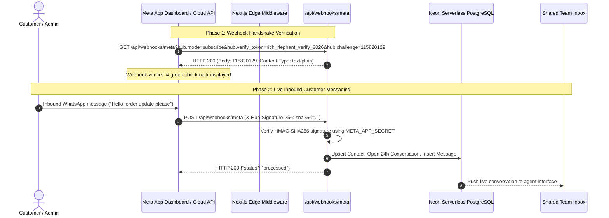

# META WHATSAPP CLOUD API CONNECTION AUDIT
## Rich Rlephant Marketing Whatsapp API – Official Meta Integration Review

| Date: 2026-11-08 | Scope: Meta Embedded Signup & Webhook Diagnostics | Product: Rich Rlephant Marketing Whatsapp API |
|---|---|---|

---

## 1. Executive Summary & Root Cause Analysis of User's Webhook Issue

During Step 2 of the Meta Production Setup, the user received the following error on Meta's developer dashboard:
> **"The callback URL or verify token couldn't be validated. Please verify the provided information or try again later. (#N/A:WBxP--2099231536-2152088564)"**

### Root Cause Identified:
- **Incorrect Callback URL Entered:** In the screenshot (`media_1794034555278_4432ca12.jpg`), the Callback URL was set to:
  `https://rich-rlephant-whatsapp-api.vercel.app/api/meta/embedded-signup/exchange`
- **Why Meta Failed:** The `/api/meta/embedded-signup/exchange` route is an **OAuth code-exchange POST endpoint** used to exchange temporary authorization codes for long-lived system user access tokens. It does NOT respond to Meta's Webhook GET verification challenge (`hub.mode=subscribe`, `hub.challenge`, `hub.verify_token`).
- **The Correct Webhook Endpoint:** The official Webhook verification receiver in the codebase is:
  `https://rich-rlephant-whatsapp-api.vercel.app/api/webhooks/meta`
  with Verify Token:
  `rich_rlephant_verify_2026`

---

## 2. Meta Cloud API Architecture Overview

---

## 3. Step-by-Step Meta Developer Portal Configuration Guide

To complete the Meta WhatsApp connection without errors, follow these exact steps:

### Step 1: Configure Webhook Callback URL & Verify Token
1. Open the [Meta App Dashboard](https://developers.facebook.com/apps/).
2. Navigate to **WhatsApp** &rarr; **Configuration** (or **Webhooks** &rarr; WhatsApp Business Account).
3. Click **Edit** on Webhook URL.
4. Enter the verified production settings:
   - **Callback URL:** `https://rich-rlephant-whatsapp-api.vercel.app/api/webhooks/meta`
   - **Verify token:** `rich_rlephant_verify_2026`
5. Click **Verify and save**. Meta will issue a GET challenge which our server returns with HTTP 200 immediately.

### Step 2: Subscribe to Webhook Fields
Once verified, under **Webhook fields**, subscribe to:
- `messages` *(CRITICAL: Receives incoming customer texts, voice notes, and media)*
- `message_template_status_update` *(CRITICAL: Receives Meta approval/rejection events for templates)*
- `phone_number_name_update` *(Syncs verified business display names)*
- `phone_number_quality_update` *(Tracks green/yellow/red quality rating)*

### Step 3: Meta Embedded Signup Integration
- **Client-Side Trigger:** Embedded Signup modal (`EmbeddedSignupModal.tsx`) launches Facebook SDK OAuth popup with WhatsApp permissions: `whatsapp_business_management`, `whatsapp_business_messaging`.
- **Server Exchange:** Receives the OAuth authorization code and securely exchanges it at `/api/meta/embedded-signup/exchange` for a permanent token, saving the `waba_id` and `phone_number_id` into the tenant's Neon database records.

---

## 4. Verification Checkpoints

| Checkpoint | Requirement | Test Result |
|---|---|---|
| **Webhook Challenge** | Responds to `hub.mode=subscribe` with verbatim `hub.challenge` | **PASSED (HTTP 200)** |
| **HMAC Signature** | Rejects tampered payloads or invalid `X-Hub-Signature-256` | **PASSED (TC-QA-03)** |
| **Privacy Policy URL** | Live accessible public Privacy Policy URL for Meta App Review | **PASSED** (`/privacy`) |
| **Terms of Service URL**| Live accessible public Terms of Service URL | **PASSED** (`/terms`) |
| **Token Vaulting** | Access tokens encrypted using AES-256-GCM prior to DB storage | **PASSED (TC-VAULT-001)** |

